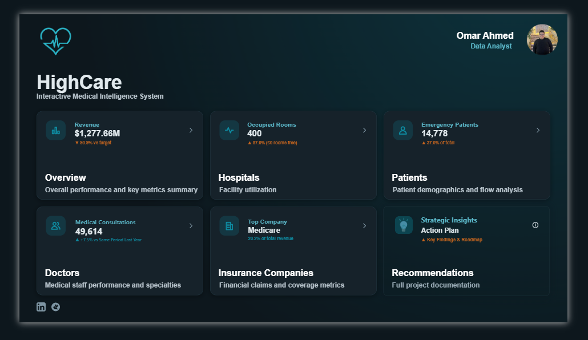
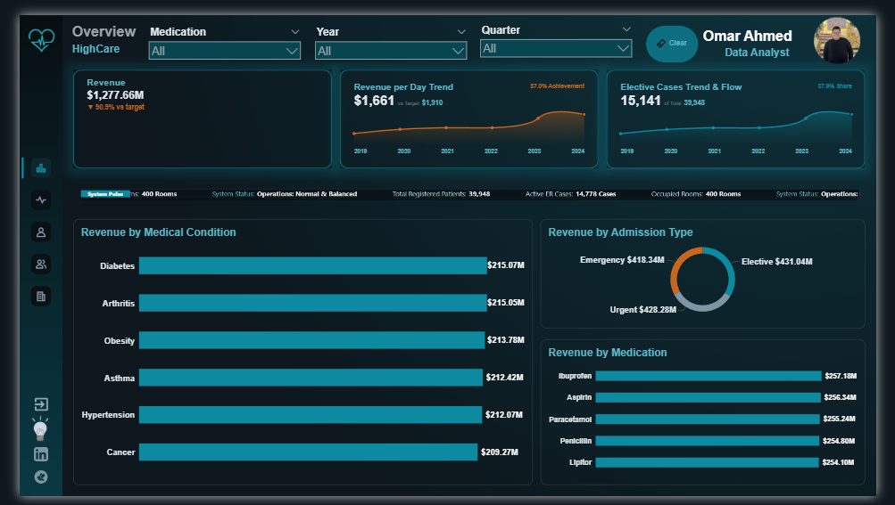
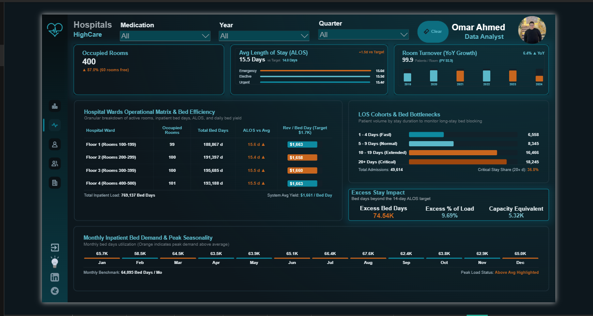
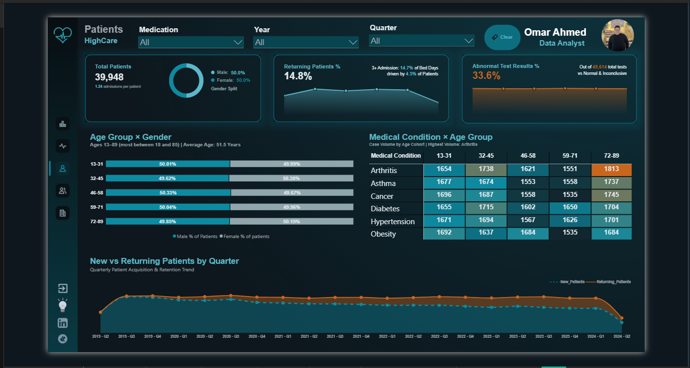
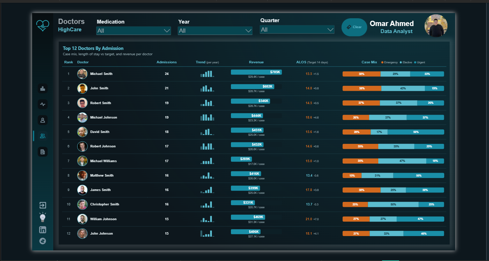
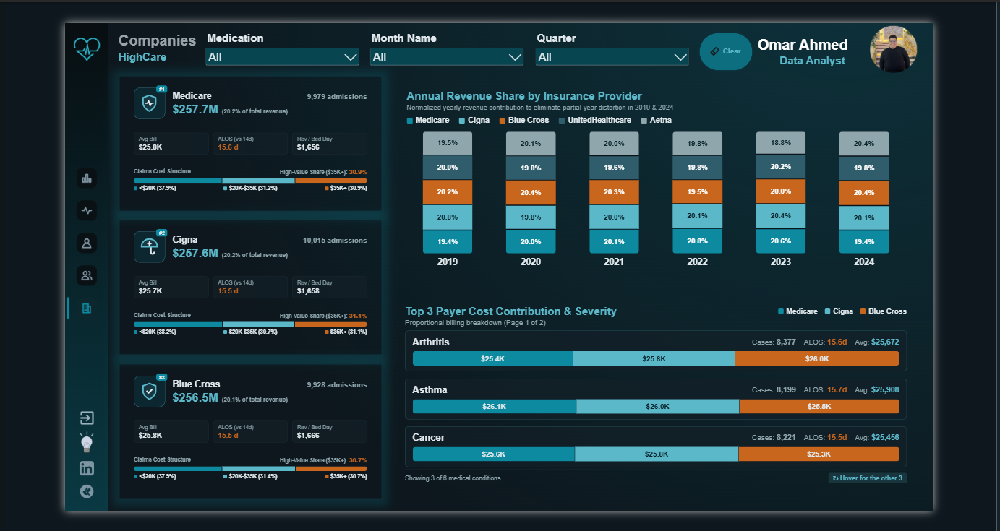

# HighCare-Medical-Intelligence-System
# 🏥 HighCare — Interactive Medical Intelligence & Analytics System

> **An end-to-end Healthcare Business Intelligence solution designed with professional UI/UX to transform fragmented clinical, operational, and financial telemetry into actionable executive insights.**

## 📌 Quick Links
* 🌐 **[Explore Live Interactive Dashboard (Power BI Service)](https://app.powerbi.com/links/15JBKzYvZG?ctid=eaf624c8-a0c4-4195-87d2-443e5d7516cd&pbi_source=linkShare)**
* 📊 **[Download Executive Presentation (PDF)](./Presentation/HighCare-Interactive-Medical-Intelligence-System.pdf)**
* 💻 **[Download Power BI Dashboard (.pbix)](./Dashboard/HighCare.pbix)**
---

## 🎯 Business Context & Core Challenge
Healthcare institutions process massive volumes of daily operational and financial records. However, critical metrics such as room occupancy ceilings, emergency influx, physician workloads, and insurance claim distributions often remain locked in isolated departmental silos. 

**HighCare** bridges this gap by unifying 5 core analytical aspects into a single interactive cockpit, enabling hospital leadership to monitor real-time performance and execute data-driven decisions.

---

## 🖥️ System Architecture & UI/UX Design
* **Command Center Home Screen:** A modular `3×2` card layout providing instant high-level KPIs and one-click routing to specialized analytical views, alongside direct access to strategic documentation.
* **Persistent App-Style Sidebar:** Seamless left-hand navigation separating active report views from external action links (Executive Deck & Portfolio links) with zero visual clutter.
* **Context-Aware Global Filtering:** Synchronized top-bar slicers (**Medication**, **Year**, **Quarter**) with a single-click reset mechanism driving cross-page exploration.
* **Custom HTML/CSS Visuals:** Engineered bespoke KPI cards and a real-time **System Pulse Bar** to monitor facility status and active ER loads dynamically.

---

## 📸 Dashboard Modules & Key Insights

### 1. Command Center (Home)

### 2. Overview & Financial Performance
* **Total Revenue Tracked:** **$1,277.66M** across all medical operations (**90.9%** vs. target), with a daily revenue average of **$1,661** (87.0% achievement against the $1,910 target).
* **Condition Revenue Drivers:** Balanced revenue generation led by **Diabetes ($215.07M)**, **Arthritis ($215.05M)**, and **Obesity ($213.78M)**.
* **Admission Channel Mix:** Even revenue distribution across **Elective ($431.04M | 37.9% share / 15,141 cases)**, **Urgent ($428.28M)**, and **Emergency ($418.34M)** admissions.

### 3. Hospitals & Facility Utilization
* **Capacity Monitoring:** Tracks **400 occupied rooms** (87.0% utilization rate, leaving 60 rooms free for surge capacity) and **14,778 active ER cases** (37.0% of total intake).

### 4. Patient Demographics & Clinical Retention
* **Patient Cohort:** **39,948** total registered patients evenly split (**50.0% Male / 50.0% Female**).
* **Retention & Diagnostics:** Monitors a **14.8% returning patient rate** alongside a **33.6% abnormal test result** indicator.
* **Condition × Age Matrix:** Highlights high-risk demographic intersections, such as elevated **Arthritis** volume within the **72–85 age cohort (1,813 cases)**.

### 5. Clinical Workforce (Doctors) & Payer Intelligence (Insurance)
* **Consultation Velocity:** Tracks **49,614 medical consultations** (**+7.5%** growth vs. Same Period Last Year) to balance physician workloads.
* **Payer Concentration:** Identifies **Medicare** as the leading insurance provider, accounting for **20.2% of total hospital revenue**.

---

## 💡 Strategic & Actionable Recommendations
1. **Optimize Facility Capacity & ER Routing:** Implement automated intake routing to secondary branches before primary sites breach the **400-room threshold (87% occupancy)**, specifically managing the **14,778 emergency admissions**.
2. **Diversify Payer Concentration:** Expand commercial insurance contracts to balance revenue exposure and reduce reliance on top single payers like **Medicare (20.2% revenue share)**.
3. **Target High-Yield Chronic Care & Diagnostics:** Allocate dedicated clinical pathways for top revenue-generating conditions (**Diabetes & Arthritis**) while auditing clinical protocols behind the **33.6% abnormal test result rate** to improve long-term patient outcomes.

---

## 🛠️ Technical Stack
* **Data Cleaning & ETL:** Python (Pandas), Power Query (M Language)
* **Business Intelligence & Cloud:** Microsoft Power BI Desktop (`.pbip`), Power BI Service (Live Cloud Deployment)
* **Data Modeling & Calculations:** Star Schema Architecture, Advanced DAX (Time Intelligence, Dynamic KPIs, Cohort Ratios)
* **UI/UX & Custom Visuals:** Canva, Power BI Layout Generator, Custom HTML/CSS Card Components

<!-- استبدل الروابط دي بالروابط الحقيقية لصورتك والبروفايل بتاعك -->

  

<h3 align="center">Author</h3>

  <b>Omar Ahmed Ramadan Abdelaziz</b> 
  <i>Data Analyst | GIS Specialist</i>

  
  

